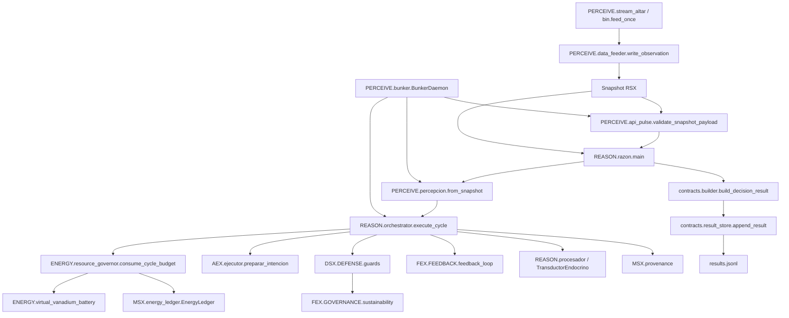
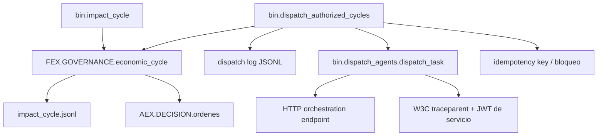
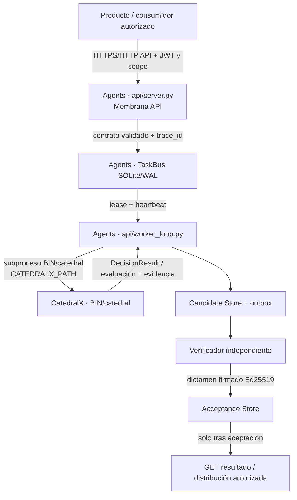

# Grafo de dependencias verificado — CatedralX

> Inventario estático de llamadas, estado persistente y protección por pruebas.  
> Repositorio: `Chalamandra-Magistral-deco/CatedralX`  
> Rama documental actualizada: `work` (CatedralX).  
> Snapshot de referencia del inventario: `62c0214d63f24cc1f5d3670e703baa70c64f2315` (main, 2026-11-23).  
> Alcance: código Python bajo `elite/`, entrypoints `elite/bin/` y pruebas bajo `tests/`.  
> Naturaleza de la evidencia: lectura estática de fuentes y tests; no equivale a telemetría de runtime ni a ejecución de CI.

## 1. Criterio de lectura

Este documento separa cinco hechos que no deben confundirse:

1. **Importa:** existe una dependencia de módulo visible en el código.
2. **Invoca:** una función o clase llama a otra en una ruta identificable.
3. **Lee/escribe:** existe una operación de acceso al estado o archivo.
4. **Está protegido:** hay una prueba que ejercita la frontera y comprueba un resultado.
5. **Está activo en runtime:** requiere evidencia de ejecución, configuración y trazas; no se infiere de los cuatro hechos anteriores.

Las flechas de los grafos indican relaciones estáticas identificadas. Una importación no prueba que el módulo se ejecute en todos los ciclos. Las rutas opcionales dependen de variables de entorno y argumentos.

## 2. Grafo de llamadas entre dominios

### 2.1 Ciclo cognitivo y resultado



**Evidencia de código:**

- `elite/PERCEIVE/stream_altar.py`: `run_once` y `accept_observation` delegan la escritura al callback `write_observation`; el flujo de proveedor usa `fetch_binance_spot_observation`.
- `elite/PERCEIVE/data_feeder.py`: `write_observation` normaliza, firma y persiste el snapshot mediante archivo temporal y reemplazo atómico.
- `elite/REASON/razon.py`: `main` lee el snapshot canónico, valida frescura/firma, construye `SensoryInput`, genera/propaga `trace_id`, llama `execute_cycle`, construye el contrato de decisión y lo persiste.
- `elite/PERCEIVE/bunker.py`: daemon alternativo; consulta pánico, lee y valida el snapshot y llama al mismo `execute_cycle`. No es un segundo motor de razonamiento.
- `elite/REASON/orchestrator.py`: `execute_cycle` valida/genera el identificador de traza, consume presupuesto de ENERGY, ejecuta el pensamiento y agrega procedencia MSX. El método interno `ejecutar_ciclo` coordina las etapas de razonamiento.
- `elite/REASON/procesador.py`: el transductor carga/guarda estado persistente; su uso por el orquestador no convierte al procesador en dueño de todo el estado de CatedralX.
- `elite/contracts/builder.py` y `elite/contracts/result_store.py`: construyen y validan `DecisionResult`; el almacén es append-only.

### 2.2 Gobernanza económica y despacho externo



**Frontera crítica:** el ledger económico registra evidencia y autorizaciones; su propio módulo declara que no mueve dinero ni coloca órdenes. El scanner solo carga propuestas autorizadas y luego llama al adaptador HTTP. El adaptador de despacho es el punto de salida de red. Las pruebas usan funciones HTTP simuladas; no demuestran que un servicio remoto real esté conectado o disponible.

- `elite/FEX/GOVERNANCE/economic_cycle.py`: `registrar_evento`, `cargar_propuesta_autorizada`, `despachar_propuesta_autorizada` y `resumir_ciclos`.
- `elite/AEX/DECISION/ordenes.py`: verificación Ed25519 y reclamación de nonce; el nonce se consume una sola vez.
- `elite/bin/dispatch_authorized_cycles.py`: escanea ciclos, comprueba elegibilidad, evita duplicados, registra despachos y llama `dispatch_task`.
- `elite/bin/dispatch_agents.py`: valida URL/destino, genera JWT de servicio de vida corta y traceparent W3C y hace la solicitud HTTP.

### 2.3 Módulos analíticos y adaptativos

Estos módulos no deben dibujarse como si todos fueran invocados en cada ciclo ordinario:

- `REASON.financial_engine.analyze_financial_market`: análisis financiero invocado desde el razonamiento.
- `REASON.dynamic_constraints.evaluate_dynamic_constraints`: restricciones dinámicas del ciclo.
- `REASON.cognitive_state`: coherencia, contraevidencia, incertidumbre y metacognición; se consume en la ruta de razonamiento y en el ciclo sintético maestro.
- `REASON.core_contract`: construcción de ciclo contractual y evaluación de oportunidad económica; dispone de CLI propia.
- `REASON.master_cycle.run_synthetic_master_cycle`: ciclo sintético separado que utiliza contrato de ciclo, guardas DSX, feedback y procedencia MSX.
- `MCX.OPTIMIZE.ganancias.financiar_analisis_adaptativo`: ruta adaptativa que exige resultado observado validado y consume presupuesto adaptativo; no equivale a una orden.
- `MCX.OPTIMIZE.kelly_vince`, `system_entropy` y otros módulos de optimización son bibliotecas de cálculo; no se debe inferir invocación por pertenecer a MCX.
- `FEX.FEEDBACK.trainer` y `FEX.trainer`: entrenamiento/funciones de pérdida; su presencia no prueba entrenamiento automático. La suite explícitamente mantiene desactivado el reentrenamiento automático.

## 3. Grafo de estado: archivos, propietarios y lectores

| Estado / archivo | Ruta predeterminada o configuración | Escritor identificado | Lectores identificados | Observación / protección |
|---|---|---|---|---|
| Snapshot RSX | `CATEDRALX_SNAPSHOT_PATH`; predeterminado `/dev/shm/cathedral_snapshot.json` | `PERCEIVE.data_feeder.write_observation` | `api_pulse`, `razon`, `orchestrator`, `bunker`, `feedback_label` | Snapshot firmado; los consumidores validan frescura. El ciclo cognitivo debe leerlo sin mutarlo. |
| Estado hormonal/cognitivo | `CATEDRALX_STATE_PATH`; predeterminado `~/.local/state/chalamandra/catedralx/hormonas.json` | `REASON.procesador.ProcesadorEndocrino.guardar` | `ProcesadorEndocrino._cargar`, `bin.nexus` | HMAC, lock, escritura temporal y reemplazo atómico; ruta fuera del repo. |
| Ledger de energía virtual | `CATEDRALX_ENERGY_LEDGER_PATH`; predeterminado `~/.catedralx/energy-ledger.jsonl` | `MSX.energy_ledger.EnergyLedger.transact/append`, llamado por `ENERGY.resource_governor` | `EnergyLedger.read`, `resource_governor._replay` | JSONL append-only, cadena hash, bloqueo y fsync. Créditos de cómputo virtual; no energía física. |
| Ledger de feedback | `CATEDRALX_FEEDBACK_PATH`; predeterminado `~/.local/state/chalamandra/catedralx/feedback.jsonl` | `FEX.FEEDBACK.feedback_loop.registrar_prediccion/registrar_resultado` | `_read_records`, `evaluar_feedback`, adaptador REASON y CLI de reporte | Predicciones y outcomes separados; solo outcome observado y horizonte vencido puede etiquetar. |
| Ledger de impacto/económico | `CATEDRALX_IMPACT_LEDGER_PATH`; predeterminado `~/.local/state/chalamandra/catedralx/impact_cycle.jsonl` | `FEX.GOVERNANCE.economic_cycle.registrar_evento` | `_read`, `cargar_propuesta_autorizada`, `resumir_ciclos`, scanner de despacho | Evidencia y autorización humana; no mueve dinero ni ejecuta operaciones por sí mismo. |
| Registro de despachos | `--dispatch-log-path` / configuración de CLI en `dispatch_authorized_cycles` | `dispatch_authorized_cycles._append_jsonl` | `_read_jsonl`, comprobación de idempotencia | Log separado del ledger de impacto; registrar despacho no equivale a aceptación o ejecución remota. |
| Ledger de nonces | `CATEDRALX_STATE_DIR/approver_nonces.jsonl` | `AEX.DECISION.ordenes._reclamar_nonce_atomico` | `_nonce_reclamado_ed25519`, verificación de identidad en economic_cycle | Nonce de aprobación, append-only y bloqueado; previene replay. |
| DecisionResult | `CATEDRALX_RESULT_STORE_PATH`; predeterminado `~/.local/state/chalamandra/catedralx/results.jsonl` | `contracts.result_store.append_result`, invocado por `REASON.razon` | `contracts.result_store.get_result` | Validación estricta, append-only, lock y fsync; no equivale a ledger económico. |
| Ledger de resultados MCX | `CATEDRALX_LEDGER_PATH`; predeterminado `~/.local/state/chalamandra/catedralx/ledger.jsonl` | `MCX.OPTIMIZE.ganancias.registrar_resultado` | No se identificó lector de runtime en el recorrido inspeccionado | No confundir con el ledger de energía ni con DecisionResult. |
| Marcador de pánico | `CATEDRALX_PANIC_PATH`; predeterminado `~/.local/state/chalamandra/catedralx/.panic` | `DSX.DEFENSE.defense.activar_panic/desactivar_panic` | `REASON.razon`, `REASON.orchestrator`, `PERCEIVE.bunker` y guardas | Archivo de veto global; el proceso debe bloquear antes de ejecutar el ciclo. |
| Lock files | Derivados del archivo principal: `.lock` o sufijo de lock | Módulos propietarios de cada ledger/estado | Los mismos procesos lectores/escritores bajo lock | Infraestructura de concurrencia; no son registros de negocio. |
| Temporales y backups de estado | Derivados de la ruta del estado | `ProcesadorEndocrino.guardar` y migración legacy | Proceso de migración/recuperación | Artefactos transitorios; migración exige preservar backup y firma. |

### 3.1 Estado en memoria (no confundir con persistencia)

- `VirtualVanadiumBattery` mantiene un ledger interno de recibos en memoria; la autoridad durable de los consumos del gobernador es `MSX.energy_ledger`.
- `Orchestrator` mantiene historial de régimen/decisiones en memoria; no es el ledger durable de outcomes.
- Los módulos de riesgo AEX mantienen memoria interna de estadísticas; no es prueba de persistencia.
- `MSX.provenance` produce registros y agregados de procedencia para el ciclo; su salida se incorpora a resultados/contratos, pero no es por sí sola un almacén durable.

## 4. Grafo de pruebas: protección por frontera

| Frontera / interacción | Pruebas directas | Garantía probada | Límite de la prueba |
|---|---|---|---|
| Snapshot writer → firma/validador | `test_snapshot_signature.py`, `test_snapshot_freshness.py` | Firma, allowlist, integridad, frescura, timestamps y rechazo fail-closed | No valida proveedor externo en producción. |
| Snapshot → entrypoint one-shot | `test_acceptance_contract.py`, `test_snapshot_freshness.py`, `test_panic_integration.py` | Snapshot inválido/obsoleto o pánico impide ciclo | Entry point ejecutado con fixtures/mocks. |
| Snapshot → daemon Bunker → Orchestrator | `test_snapshot_freshness.py`, `test_panic_integration.py`, `test_acceptance_contract.py` | Rechazo de datos obsoletos, pánico antes de lectura y snapshot no mutado | No es prueba de daemon desplegado/activo. |
| Orchestrator → ENERGY → MSX | `test_trace_propagation.py`, `test_msx_energy_ledger.py`, `test_virtual_vanadium_battery.py` | Presupuesto previo, reservas, persistencia, secuencia, hash, duplicados y corrupción | No mide consumo real de infraestructura física. |
| ENERGY adaptativo → MCX → FEX feedback | `test_mcx_adaptive_budget.py` | Solo outcome verificado/horizonte vencido permite gastar crédito adaptativo | No demuestra mejora de modelo ni rentabilidad. |
| REASON → AEX → contrato de acción | `test_action_contract.py` | Normalización de señales, validación de tamaño/riesgo y no habilitación de ejecución | Prueba contrato/intención, no broker. |
| DSX → MCX restricciones | `test_dsx_mcx_contracts.py`, `test_dynamic_constraints.py` | Veto por pánico, métricas ausentes y restricciones no verificadas | No cubre cada ruta de guardas en producción. |
| FEX sostenibilidad → DSX | `test_sustainability_governance.py`, `test_acceptance_contract.py` | Firma/integridad de evidencia, rotación de claves y bloqueo ante evidencia ausente/tamper | No demuestra aceptación independiente externa. |
| FEX feedback → resultados observados | `test_feedback_loop.py`, `test_chalamandra_fex_feedback_adapter.py`, `test_acceptance_contract.py` | Identidad de predicción, horizontes, source matching, no duplicación, pendientes y corrupción | No prueba calibración estadística fuera de fixtures. |
| REASON/core contract → hash de evaluación | `test_chalamandra_core_contract.py`, `test_evaluation_hash_verification.py` | Contrato canónico, hash, detección de manipulación y CLI | No prueba aceptación de negocio independiente. |
| REASON → DecisionResult → ResultStore | `test_decision_result.py`, `test_trace_propagation.py` | Esquema, evidencia/procedencia, trace_id, bloqueo, persistencia, concurrencia y permisos | No equivale a aceptación/entrega por consumidor externo. |
| MSX → manifiesto firmado | `test_cycle_manifest.py` | Hash canónico, inmutabilidad, firma y detección de alteración | No sustituye la verificación de snapshots originales. |
| FEX económico → AEX identidad/nonce | `test_economic_cycle.py`, `test_dispatch_agents.py` | Secuencia de etapas, aprobación humana, firma Ed25519, nonce de un solo uso y rechazo de ledger corrupto | Algunas identidades se simulan; no equivale a aprobación real de usuario en producción. |
| Ledger autorizado → scanner → HTTP dispatch | `test_dispatch_authorized_cycles.py`, `test_dispatch_agents.py` | Elegibilidad, secreto dedicado, JWT, traceparent, idempotencia, no duplicar y no despachar sin autorización | HTTP está simulado; no prueba disponibilidad ni aceptación del servicio remoto. |
| Pánico → puntos de entrada | `test_panic_integration.py`, `test_acceptance_contract.py` | El marcador de pánico bloquea Bunker y one-shot antes del ciclo | No es una prueba de failover del host. |
| Estado hormonal → firma/recuperación | `test_hormonal_state_integrity.py`, `test_unified_state.py` | HMAC, permisos, migración legacy, key rotation, ruta canónica y escritura temporal | No cubre corrupción de disco/host externo. |
| MCX métricas y analítica | `test_mcx_ganancias.py`, `test_financial_engine.py`, `test_kelly_uniqueness.py` | Cálculos, restricciones de datos y resultados append-only | No demuestra desempeño predictivo ni resultado financiero real. |
| Feedback de usuario | `test_user_feedback.py` | Validación del contrato de feedback del usuario | No prueba adopción ni procesamiento externo. |
| Transporte HTTP | `test_http_transport.py` | Política de transporte/redirects | No es prueba de endpoint remoto conectado. |
| Sensores y continuidad de velas | `test_backtest_public_candles.py`, `test_candle_continuity.py` | Integridad/continuidad de datos históricos de mercado | No prueba streaming live. |
| Vectores y funciones auxiliares | `test_cathedral_vectors.py`, `test_free_energy.py`, `test_multicriteria.py`, `test_cognitive_state.py`, `test_resource_monitor.py` | Contratos matemáticos y auxiliares de los módulos | Unitarias locales; no prueban por sí solas integración end-to-end. |

## 5. Catálogo de pruebas inspeccionado

El árbol del commit contiene **37 archivos Python bajo `tests/`**:

- `test_acceptance_contract.py`
- `test_action_contract.py`
- `test_backtest_public_candles.py`
- `test_candle_continuity.py`
- `test_cathedral_vectors.py`
- `test_chalamandra_core_contract.py`
- `test_chalamandra_fex_feedback_adapter.py`
- `test_cognitive_state.py`
- `test_cycle_manifest.py`
- `test_decision_result.py`
- `test_dispatch_agents.py`
- `test_dispatch_authorized_cycles.py`
- `test_dsx_mcx_contracts.py`
- `test_dynamic_constraints.py`
- `test_economic_cycle.py`
- `test_economic_feedback.py`
- `test_evaluation_hash_verification.py`
- `test_feedback_loop.py`
- `test_financial_engine.py`
- `test_free_energy.py`
- `test_hormonal_state_integrity.py`
- `test_http_transport.py`
- `test_kelly_uniqueness.py`
- `test_mcx_adaptive_budget.py`
- `test_mcx_ganancias.py`
- `test_msx_energy_ledger.py`
- `test_multicriteria.py`
- `test_order_safety.py`
- `test_panic_integration.py`
- `test_resource_monitor.py`
- `test_snapshot_freshness.py`
- `test_snapshot_signature.py`
- `test_sustainability_governance.py`
- `test_trace_propagation.py`
- `test_unified_state.py`
- `test_user_feedback.py`
- `test_virtual_vanadium_battery.py`


## 6. Hallazgos y riesgos de frontera

1. **Dos entrypoints de ciclo:** `REASON.razon` y `PERCEIVE.bunker` comparten `execute_cycle`; ambos deben mantener las mismas validaciones de pánico y snapshot.
2. **Dos ledgers económicos distintos:** `FEX.FEEDBACK.feedback_loop` registra predicciones/outcomes; `FEX.GOVERNANCE.economic_cycle` registra medición, evaluación, propuesta, autorización, verificación y feedback. No deben fusionarse ni confundirse.
3. **Tres registros que no son intercambiables:** `DecisionResult`, ledger de energía y ledger económico. Tienen propietarios, esquemas y propósitos diferentes.
4. **MCX ledger legacy:** `CATEDRALX_LEDGER_PATH` es independiente del ledger energético y de resultados; el recorrido estático no encontró lector runtime correspondiente.
5. **Dispatch no es ejecución de orden:** el flujo externo envía una tarea de revisión a un endpoint de orquestación. El código y las pruebas mantienen explícitamente `orders_created=false` y `orders_executed=false`.
6. **Imports no prueban uso efectivo:** algunos módulos de optimización, trainers y utilidades pueden ser bibliotecas disponibles sin estar en la ruta activa del ciclo.
7. **Pruebas no equivalen a cobertura total:** existen pruebas unitarias y de integración simulada; no se ha ejecutado aquí la suite ni se ha calculado cobertura por rama.

## 7. Estado de cierre de Fase A

| Criterio | Resultado |
|---|---|
| Árbol de archivos del commit | Completo y no truncado |
| Módulos Python de runtime | 96 identificados |
| Archivos Python de pruebas | 37 identificados |
| Grafo principal de llamadas | Documentado con rutas de código |
| Grafo de estado persistente | Documentado con propietarios, lectores y rutas configurables |
| Grafo de pruebas por frontera | Asociado a pruebas existentes y límites de garantía |
| Integración real de servicios remotos | No inferida; pendiente de evidencia de runtime |
| Ejecución de suite / cobertura | No ejecutada en esta fase |
| Merge / despliegue | No realizado |

**Criterio de aceptación:** Fase A queda documentada como inventario estático trazable. No debe etiquetarse como validación dinámica, cobertura total de ejecución ni certificación de integraciones activas hasta ejecutar pruebas y obtener trazas/telemetría del runtime.

## 8. Fuentes de verdad

- Código: `elite/` y `elite/bin/` en el commit identificado al inicio.
- Pruebas: `tests/` en el mismo commit.
- Contrato de arquitectura: [CONTRATO_ARQUITECTONICO.md](./CONTRATO_ARQUITECTONICO.md).
- Mapa sagrado: [MAPA_SAGRADO.md](./MAPA_SAGRADO.md).


## 7. Membrana API empresarial: frontera CatedralX ↔ Agents

**Definición arquitectónica:** la Membrana API no es un octavo subsistema de CatedralX ni un repositorio comercial separado. Es la frontera contractual de integración expuesta por la API de Agents. CatedralX conserva la autoridad de razonamiento y producción de resultados; Agents aloja la entrada HTTP, la cola/worker, la coordinación y los mecanismos de publicación y aceptación.

### 7.1 Topología comprobada en código



### 7.2 Responsabilidades y controles

| Frontera | Implementación identificada | Garantía / límite |
|---|---|---|
| Entrada HTTP | `api/server.py` | Rutas explícitas; límite de cuerpo 64 KiB; sin shell arbitraria ni CORS; JWT Bearer y scopes por operación. |
| Contrato de tarea | `api/task_contracts.py` | Valida tipos de tarea y payloads; evaluación de oportunidad exige evidencia, referencias, escenarios y `trace_id`; datos de mercado requieren attestation verificable. |
| Cola | `api/task_bus.py` | TaskBus persistente SQLite/WAL con leases y estados; no es un bus universal de eventos distribuido. |
| Worker | `api/worker_loop.py` | Consume tareas con lease/heartbeat y ejecuta CatedralX como subproceso usando `BIN/catedral`; conserva y valida traza, snapshot y hash de evaluación. |
| Resultado candidato | `api/candidate_store.py` y stores relacionados | Persistencia append-only e integridad HMAC del candidato; publicar candidato no equivale a aceptación independiente. |
| Aceptación | `api/acceptance_store.py` y verificador independiente | La aceptación requiere dictamen separado y firma Ed25519; no se infiere del despacho ni de la publicación. |
| Retorno | rutas de resultados de `api/server.py` | El resultado no se entrega como aceptado hasta completar el estado de aceptación correspondiente. |

### 7.3 Tres flujos empresariales

1. **Normal:** producto/usuario autorizado → Membrana API de Agents → TaskBus → worker → CatedralX → resultado candidato y evidencia.
2. **Inverso:** candidato publicado → verificador independiente → aceptación firmada → consulta/entrega o distribución autorizada.
3. **Invertido:** condición o evento autorizado → despachador de CatedralX → Membrana API de Agents → TaskBus/worker → CatedralX → evidencia y verificación. El adaptador de despacho es opt-in; el flujo no se presume activo por existir el código.

### 7.4 Invariantes que no deben colapsarse

- `dispatch_accepted` ≠ `execution_completed` ≠ `candidate_published` ≠ `independent_acceptance`.
- `trace_id` identifica la traza; `cycle_id` es identificador de negocio y no la sustituye.
- El JWT de servicio autentica el despacho; la firma Ed25519 autentica el dictamen de aceptación. Son mecanismos y propósitos distintos.
- La Membrana puede autenticar, autorizar, validar contratos, limitar y enrutar; no reemplaza el razonamiento de CatedralX ni sus invariantes de dominio.
- Los productos consumen capacidades a través de Agents/Membrana API; no reciben acceso directo al motor interno de CatedralX.
- No se debe presentar esta topología de código como runtime activo. La evidencia inspeccionada es estática y de pruebas aisladas; no se hizo una llamada real entre servicios en esta actualización.

### 7.5 Criterio externo de diseño

La guía NIST SP 800-228 (API Protection for Cloud-Native Systems) recomienda autorización granular por identidad de servicio/usuario, validación de solicitudes y respuestas contra esquema, y orden de autenticación → autorización → validación de negocio. Se usa como criterio de revisión, no como prueba de que cada control esté desplegado:
- https://csrc.nist.gov/pubs/sp/800/228/upd1/final
- https://nvlpubs.nist.gov/nistpubs/SpecialPublications/NIST.SP.800-228-upd1.pdf

**Estado de evidencia:** código de API/contratos/worker y pruebas de integración aisladas identificados; runtime entre repositorios no verificado en esta actualización.


## 9. Protocolo transversal de auditoría: evidencia, capas y permisos

**Propósito:** convertir el ranking de inspección en un procedimiento reproducible. La auditoría debe descubrir qué puede demostrar cada capa y qué puede ocultar de las capas inferiores. Una capa superior saludable no acredita automáticamente la salud de sus dependencias.

### 9.1 Reglas de evidencia

- Registrar para cada observación: repositorio, rama, commit SHA, fecha/hora, entorno, comando exacto, resultado/artefacto y alcance.
- Distinguir **existencia**, **configuración**, **invocación**, **resultado de prueba** y **actividad real en runtime**. Ninguna sustituye a las demás.
- Comparar cambios contra una línea base previa, identificada por SHA y medición. Si no existe línea base previa, declararlo y establecer una nueva antes de optimizar; no reconstruirla retrospectivamente.
- No optimizar aquello que no se ha medido. Un test verde no cuantifica latencia, consumo, fiabilidad ni mejora.
- La observabilidad es parcial: declarar estados no instrumentados, rutas opcionales, efectos externos y sesgos de muestreo.
- La disponibilidad de una herramienta no determina la importancia de la capa. Evitar el **sesgo de la mano**: inspeccionar una capa con más detalle solo porque allí existen mejores herramientas no debe convertirla en la capa de mayor prioridad.
- Una medición puede alterar el sistema observado. Inspección estática, lectura de telemetría existente y experimentos activos deben etiquetarse por separado.

### 9.2 Orden de inspección por capas

El orden es un procedimiento de reducción de incertidumbre, no un ranking de valor ni una afirmación de que una capa sea más importante que otra.

| Orden | Capa / pregunta | Evidencia y comandos de lectura | Criterio de aceptación | Señal de alerta |
|---|---|---|---|---|
| 1 | Identidad del artefacto: ¿qué código y configuración se están evaluando? | `git status --porcelain`; `git log -1 --format='%H %cI %s'`; `git branch --show-current`; `git diff --stat`; inventario de archivos y manifiestos | SHA, rama, cambios locales y entorno identificados; evidencia ligada a un artefacto inmutable | SHA desconocido, árbol sucio no declarado, artefactos mezclados o evidencia de otro commit |
| 2 | Perímetro y transporte: ¿qué entradas y salidas están expuestas? | Inspección de rutas, proxy, configuración TLS, límites de cuerpo, redirects y dependencias de red; lectura de manifiestos y configuración | Superficies expuestas enumeradas; límites y destinos explícitos; ninguna ruta sensible inferida solo por documentación | Rutas no inventariadas, redirects inesperados, exposición administrativa o límites ausentes |
| 3 | Identidad, autenticación y autorización: ¿quién puede hacer qué? | Inspección de middleware, validadores JWT/firma, scopes, audiencias, subjects, políticas y pruebas negativas | Mínimo privilegio; identidad, acción y recurso comprobados; rechazo por defecto ante credenciales/scope inválidos | Token aceptado fuera de audiencia, scope excesivo, autorización solo en cliente o identidad ambigua |
| 4 | Contratos y datos: ¿qué se acepta, transforma y devuelve? | Esquemas, validadores, serialización canónica, hashes, versionado, validación request/response y fixtures | Contratos versionados y validación en ambas direcciones; invariantes y compatibilidad demostradas con pruebas | Campos obligatorios omitidos, coerciones silenciosas, hash sobre serialización no canónica o deriva entre productores y consumidores |
| 5 | Orquestación y colas: ¿qué tarea se programa y qué estado alcanza? | Lectura de estados, leases, heartbeats, reintentos, idempotencia, timeouts, dead-letter y límites de concurrencia | Transiciones explícitas, idempotencia y recuperación acotada; estados no colapsados | Reintentos infinitos, leases huérfanos, doble despacho o aceptación inferida de un HTTP 202 |
| 6 | Ejecución y dependencias: ¿qué proceso ejecuta realmente el trabajo? | Entry points, subprocess/HTTP calls, versiones, imágenes, digest, permisos del proceso y pruebas de integración | Ejecutable y dependencias fijados; llamadas y efectos secundarios delimitados; evidencia de prueba atribuida al SHA correcto | Importación confundida con invocación, dependencia flotante o proceso externo no inventariado |
| 7 | Estado y persistencia: ¿quién escribe, quién lee y cómo se recupera? | Inventario de stores, rutas, locks, WAL, fsync, retención, migraciones, backups y lectores/escritores | Propietario, esquema, concurrencia, integridad y recuperación documentados; registros separados por propósito | Escritores múltiples sin coordinación, truncamiento no detectado, migración destructiva o ledger confundido con otro |
| 8 | Runtime y observabilidad: ¿qué ocurrió efectivamente? | Solo telemetría/logs/trazas ya disponibles, health/readiness y métricas existentes; correlación por trace_id y ventana temporal | Evento correlacionado con entorno, versión, timestamp y resultado; huecos de telemetría declarados | Métricas sin procedencia, trazas parciales, reloj desalineado o salud inferida desde un test aislado |
| 9 | Resultado de negocio y aceptación independiente: ¿qué se entregó y quién lo aceptó? | Registros de candidato, verificador, dictamen firmado, entrega, feedback y conciliación de resultados | Separación verificable entre despacho, ejecución, publicación, aceptación y entrega; aceptación ligada al artefacto exacto | Éxito técnico tratado como valor de negocio o aceptación derivada de quien produjo el candidato |

**Regla de lectura:** una capa superior puede ocultar fallos de una inferior (por ejemplo, una API saludable con worker detenido, o un worker sano con un contrato incompatible). Por eso, cada capa debe tener evidencia propia y sus dependencias deben verificarse hacia abajo; no basta con que el primer health check responda.

### 9.3 Permisos: identidad, alcance, tiempo y volumen

#### 9.3.1 Doble identidad en la Membrana API

La autorización de una llamada debe distinguir, cuando ambas identidades existan:

- **Principal consumidor:** usuario, organización o producto en cuyo nombre se solicita la operación.
- **Principal de servicio/workload:** aplicación o servicio que transporta y ejecuta técnicamente la llamada.

La Membrana debe autenticar el principal de servicio y, cuando el flujo represente a un usuario o producto, conservar y validar también el principal consumidor. La identidad del servicio no sustituye ni amplía los permisos del consumidor.

La decisión de autorización debe vincular explícitamente:
`principal_consumidor` (si aplica), `principal_servicio`, `audience`, `scope/action`, `resource/tenant`, vigencia y límites de consumo. Debe rechazarse por defecto una combinación no autorizada. No confiar en identidad, tenant, scope o claims enviados únicamente en cabeceras o payloads sin validación criptográfica y de política en el servidor.

Para llamadas servicio-a-servicio sin usuario final, declarar explícitamente ese contexto y autorizar el workload por audiencia, acción y recurso; no inventar un principal de usuario. Para operaciones delegadas, registrar quién delega, a quién, para qué recurso y durante qué vigencia.

**Criterio de aceptación:** pruebas positivas y negativas demuestran que (a) un servicio autenticado no puede actuar fuera de sus scopes/recursos; (b) un consumidor no puede elevar privilegios mediante un servicio intermediario; (c) tokens con audiencia incorrecta, expirados o con scope/recurso no permitido se rechazan; y (d) la decisión queda correlacionada con `trace_id` y el identificador de negocio correspondiente, sin confundirlos.

**Señales de alerta:** identidad del consumidor perdida en el salto API→worker; autorización basada solo en el subject del servicio; token aceptado para otra audiencia; tenant tomado del payload sin vinculación al principal; o credenciales internas reutilizadas como autorización general para productos.

**Aplicación al diseño Chalamandra:** Agents puede autenticarse como workload frente a la Membrana, pero esa identidad no concede acceso irrestricto a CatedralX. Cada producto consumidor conserva su frontera de autorización; CatedralX recibe únicamente solicitudes admitidas por el contrato de la Membrana.


Cada permiso de ejecución o integración debe evaluarse en cuatro dimensiones independientes:

1. **Quién:** identidad autenticada del usuario, servicio o workload.
2. **Qué y sobre qué:** acción/scope y recurso, tenant, objeto o conjunto de datos permitido.
3. **Cuándo:** vigencia, TTL, ventana temporal, expiración y condiciones de renovación.
4. **Cuánto:** cuota acumulada por periodo, rate limit por intervalo corto, concurrencia máxima y límites de tamaño/coste.

No intercambiar conceptos:
- **TTL** limita la vigencia de una credencial o autorización.
- **Rate limit** limita la frecuencia de solicitudes en una ventana corta para proteger capacidad y equidad.
- **Cuota** limita el consumo acumulado durante un periodo más largo o un presupuesto.
- **Concurrencia** limita el trabajo simultáneo; no queda resuelta por limitar solicitudes por minuto.

Criterio de aceptación: los límites están asociados a identidad y recurso, se aplican en el servidor y producen rechazo/telemetría verificables. Señales de alerta: límites solo en frontend, tokens sin audiencia/expiración adecuada, cuota global que permite abuso por caller o reintentos que eluden el rate limit.

### 9.4 Comandos de inspección y límites de lectura

Los comandos deben adaptarse al stack y ejecutarse desde el repositorio/entorno declarado. Ejemplos de inspección local:

```bash
# Identidad Git y cambios locales
git status --porcelain
git log -1 --format='%H %cI %s'
git branch --show-current
git diff --stat

# Inventario estructural y tamaño de archivos
find . -maxdepth 3 -type f -not -path './.git/*' -print | sort
wc -l $(git ls-files '*.py' '*.ts' '*.js' '*.go' '*.rs' 2>/dev/null)

# Búsqueda estática de secretos potenciales (requiere revisión manual de falsos positivos)
grep -RInE '(api[_-]?key|secret|password|token)[[:space:]]*[:=]' \
  --exclude-dir=.git --exclude-dir=.venv .

# Dependencias, CI y contenedores: leer archivos versionados, no reconstruir ni ejecutar
git ls-files '*lock*' 'pyproject.toml' 'requirements*.txt' 'Dockerfile*' '.github/workflows/*'
```

- **Qué miden:** identidad del código, cambios no confirmados, estructura, tamaño, patrones sospechosos y manifiestos de dependencias/CI.
- **Aceptación:** salida guardada o resumida junto al SHA y sin secretos expuestos en el informe.
- **Alerta:** árbol sucio no explicado, dependencias sin fijar, secretos confirmados o archivos de configuración fuera del inventario.
- **Límites:** `grep` no certifica ausencia de secretos; `wc` no mide complejidad; inspección de Dockerfile no prueba que la imagen construya; `git status` no detecta efectos externos ni estado de runtime.
- **Lectura pura:** estos ejemplos no escriben deliberadamente en el repositorio. Algunos comandos de diagnóstico pueden crear cachés o archivos temporales; no incluirlos en una auditoría estrictamente no invasiva sin verificar su comportamiento. No usar `compileall`, instalaciones, builds, migraciones, tests que muten estado, profiling ni benchmarks como si fueran lectura pura.
- **Privilegios:** no usar `sudo` por defecto. Si una fuente requiere privilegios, marcarlo y justificarlo; no elevar permisos solo para completar el checklist.

### 9.5 Validación cuantitativa y efecto del observador

Las pruebas funcionales, los benchmarks y el profiling son actividades distintas de la inspección estática. Requieren autorización y condiciones controladas cuando pueden consumir recursos, generar tráfico, escribir estado o afectar usuarios.

Para una comparación cuantitativa:
- Definir hipótesis, métrica, unidad, ventana, carga, entorno y criterio de reversión antes de ejecutar.
- Usar la misma carga y configuración para línea base y candidato; registrar SHA, hardware, versión, warm-up y número de repeticiones.
- Informar distribución (por ejemplo, p50/p95/p99), tamaño de muestra y variabilidad; no seleccionar solo la corrida favorable.
- Separar coste de instrumentación del coste del sistema y declarar la perturbación potencial.
- Si no existe línea base comparable, no afirmar mejora o regresión cuantificada.

### 9.6 Referencias externas de diseño

Estas fuentes sustentan criterios generales; no prueban que los controles estén implementados o activos en este repositorio:

- NIST SP 800-228, *Guidelines for API Protection for Cloud-Native Systems*: controles de autenticación/autorización, validación, límites de consumo y protección de APIs. https://csrc.nist.gov/pubs/sp/800/228/upd1/final
- RFC 9700, *Best Current Practice for OAuth 2.0 Security*: mínimo privilegio y restricción de tokens por audiencia, recurso y alcance. https://www.rfc-editor.org/rfc/rfc9700
- NIST SP 800-92, *Guide to Computer Security Log Management*: gestión y análisis de registros de seguridad. https://csrc.nist.gov/pubs/sp/800/92/final
- *Observer Effect and Measurement Bias in Performance Analysis*: la instrumentación y el contexto experimental pueden perturbar y sesgar mediciones. https://sape.inf.usi.ch/sites/default/files/publication/CU-CS-1042-08.pdf

**Estado:** protocolo metodológico documentado. No es una auditoría ejecutada de todas las capas, no establece una línea base de rendimiento y no certifica el estado productivo. Toda conclusión posterior debe aportar evidencia propia por capa y por commit.
