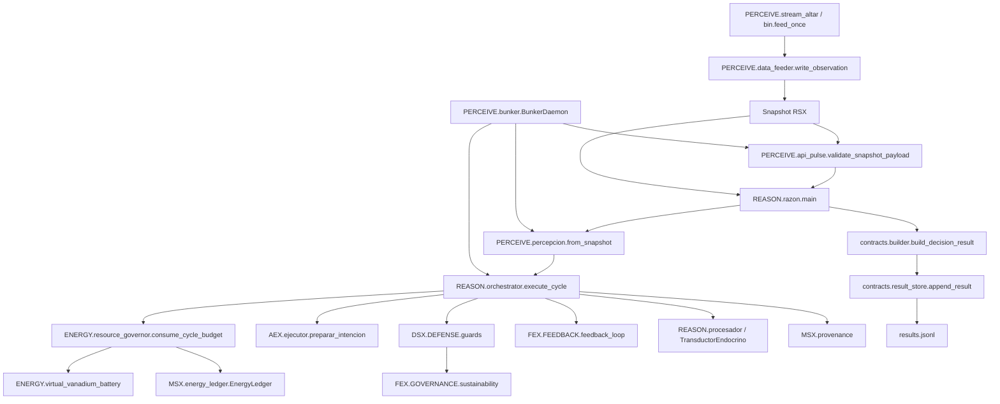
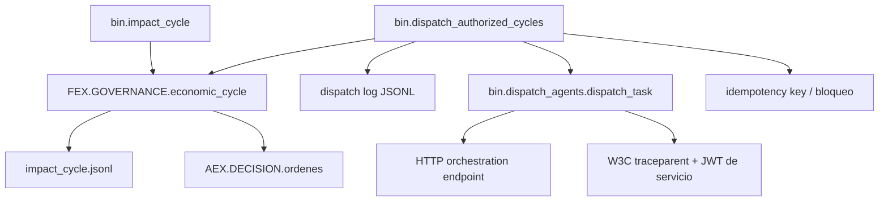

# Grafo de dependencias verificado — CatedralX

> Inventario estático de llamadas, estado persistente y protección por pruebas.  
> Repositorio: `Chalamandra-Magistral-deco/CatedralX`  
> Rama inspeccionada: `fix/perceive-contract-hardening-20261122`  
> Commit base inspeccionado: `e2faa3d16b1e0c6489480d55d348e387e8a8685e`  
> Alcance: código Python bajo `elite/`, entrypoints `elite/bin/` y pruebas bajo `tests/`.  
> Naturaleza de la evidencia: lectura estática de fuentes y tests; no equivale a telemetría de runtime ni a ejecución de CI.

## 1. Criterio de lectura

Este documento separa cinco hechos que no deben confundirse:

1. **Importa:** existe una dependencia de módulo visible en el código.
2. **Invoca:** una función o clase llama a otra en una ruta identificable.
3. **Lee/escribe:** existe una operación de acceso al estado o archivo.
4. **Está protegido:** hay una prueba que ejercita la frontera y comprueba un resultado.
5. **Está activo en runtime:** requiere evidencia de ejecución, configuración y trazas; no se infiere de los cuatro hechos anteriores.

Las flechas de los grafos indican relaciones estáticas identificadas. Una importación no prueba que el módulo se ejecute en todos los ciclos. Las rutas opcionales dependen de variables de entorno y argumentos.

## 2. Grafo de llamadas entre dominios

### 2.1 Ciclo cognitivo y resultado

**Evidencia de código:**

- `elite/PERCEIVE/stream_altar.py`: `run_once` y `accept_observation` delegan la escritura al callback `write_observation`; el flujo de proveedor usa `fetch_binance_spot_observation`.
- `elite/PERCEIVE/data_feeder.py`: `write_observation` normaliza, firma y persiste el snapshot mediante archivo temporal y reemplazo atómico.
- `elite/REASON/razon.py`: `main` lee el snapshot canónico, valida frescura/firma, construye `SensoryInput`, genera/propaga `trace_id`, llama `execute_cycle`, construye el contrato de decisión y lo persiste.
- `elite/PERCEIVE/bunker.py`: daemon alternativo; consulta pánico, lee y valida el snapshot y llama al mismo `execute_cycle`. No es un segundo motor de razonamiento.
- `elite/REASON/orchestrator.py`: `execute_cycle` valida/genera el identificador de traza, consume presupuesto de ENERGY, ejecuta el pensamiento y agrega procedencia MSX. El método interno `ejecutar_ciclo` coordina las etapas de razonamiento.
- `elite/REASON/procesador.py`: el transductor carga/guarda estado persistente; su uso por el orquestador no convierte al procesador en dueño de todo el estado de CatedralX.
- `elite/contracts/builder.py` y `elite/contracts/result_store.py`: construyen y validan `DecisionResult`; el almacén es append-only.

### 2.2 Gobernanza económica y despacho externo

**Frontera crítica:** el ledger económico registra evidencia y autorizaciones; su propio módulo declara que no mueve dinero ni coloca órdenes. El scanner solo carga propuestas autorizadas y luego llama al adaptador HTTP. El adaptador de despacho es el punto de salida de red. Las pruebas usan funciones HTTP simuladas; no demuestran que un servicio remoto real esté conectado o disponible.

- `elite/FEX/GOVERNANCE/economic_cycle.py`: `registrar_evento`, `cargar_propuesta_autorizada`, `despachar_propuesta_autorizada` y `resumir_ciclos`.
- `elite/AEX/DECISION/ordenes.py`: verificación Ed25519 y reclamación de nonce; el nonce se consume una sola vez.
- `elite/bin/dispatch_authorized_cycles.py`: escanea ciclos, comprueba elegibilidad, evita duplicados, registra despachos y llama `dispatch_task`.
- `elite/bin/dispatch_agents.py`: valida URL/destino, genera JWT de servicio de vida corta y traceparent W3C y hace la solicitud HTTP.

### 2.3 Módulos analíticos y adaptativos

Estos módulos no deben dibujarse como si todos fueran invocados en cada ciclo ordinario:

- `REASON.financial_engine.analyze_financial_market`: análisis financiero invocado desde el razonamiento.
- `REASON.dynamic_constraints.evaluate_dynamic_constraints`: restricciones dinámicas del ciclo.
- `REASON.cognitive_state`: coherencia, contraevidencia, incertidumbre y metacognición; se consume en la ruta de razonamiento y en el ciclo sintético maestro.
- `REASON.core_contract`: construcción de ciclo contractual y evaluación de oportunidad económica; dispone de CLI propia.
- `REASON.master_cycle.run_synthetic_master_cycle`: ciclo sintético separado que utiliza contrato de ciclo, guardas DSX, feedback y procedencia MSX.
- `MCX.OPTIMIZE.ganancias.financiar_analisis_adaptativo`: ruta adaptativa que exige resultado observado validado y consume presupuesto adaptativo; no equivale a una orden.
- `MCX.OPTIMIZE.kelly_vince`, `system_entropy` y otros módulos de optimización son bibliotecas de cálculo; no se debe inferir invocación por pertenecer a MCX.
- `FEX.FEEDBACK.trainer` y `FEX.trainer`: entrenamiento/funciones de pérdida; su presencia no prueba entrenamiento automático. La suite explícitamente mantiene desactivado el reentrenamiento automático.

## 3. Grafo de estado: archivos, propietarios y lectores

| Estado / archivo | Ruta predeterminada o configuración | Escritor identificado | Lectores identificados | Observación / protección |
|---|---|---|---|---|
| Snapshot RSX | `CATEDRALX_SNAPSHOT_PATH`; predeterminado `/dev/shm/cathedral_snapshot.json` | `PERCEIVE.data_feeder.write_observation` | `api_pulse`, `razon`, `orchestrator`, `bunker`, `feedback_label` | Snapshot firmado; los consumidores validan frescura. El ciclo cognitivo debe leerlo sin mutarlo. |
| Estado hormonal/cognitivo | `CATEDRALX_STATE_PATH`; predeterminado `~/.local/state/chalamandra/catedralx/hormonas.json` | `REASON.procesador.ProcesadorEndocrino.guardar` | `ProcesadorEndocrino._cargar`, `bin.nexus` | HMAC, lock, escritura temporal y reemplazo atómico; ruta fuera del repo. |
| Ledger de energía virtual | `CATEDRALX_ENERGY_LEDGER_PATH`; predeterminado `~/.catedralx/energy-ledger.jsonl` | `MSX.energy_ledger.EnergyLedger.transact/append`, llamado por `ENERGY.resource_governor` | `EnergyLedger.read`, `resource_governor._replay` | JSONL append-only, cadena hash, bloqueo y fsync. Créditos de cómputo virtual; no energía física. |
| Ledger de feedback | `CATEDRALX_FEEDBACK_PATH`; predeterminado `~/.local/state/chalamandra/catedralx/feedback.jsonl` | `FEX.FEEDBACK.feedback_loop.registrar_prediccion/registrar_resultado` | `_read_records`, `evaluar_feedback`, adaptador REASON y CLI de reporte | Predicciones y outcomes separados; solo outcome observado y horizonte vencido puede etiquetar. |
| Ledger de impacto/económico | `CATEDRALX_IMPACT_LEDGER_PATH`; predeterminado `~/.local/state/chalamandra/catedralx/impact_cycle.jsonl` | `FEX.GOVERNANCE.economic_cycle.registrar_evento` | `_read`, `cargar_propuesta_autorizada`, `resumir_ciclos`, scanner de despacho | Evidencia y autorización humana; no mueve dinero ni ejecuta operaciones por sí mismo. |
| Registro de despachos | `--dispatch-log-path` / configuración de CLI en `dispatch_authorized_cycles` | `dispatch_authorized_cycles._append_jsonl` | `_read_jsonl`, comprobación de idempotencia | Log separado del ledger de impacto; registrar despacho no equivale a aceptación o ejecución remota. |
| Ledger de nonces | `CATEDRALX_STATE_DIR/approver_nonces.jsonl` | `AEX.DECISION.ordenes._reclamar_nonce_atomico` | `_nonce_reclamado_ed25519`, verificación de identidad en economic_cycle | Nonce de aprobación, append-only y bloqueado; previene replay. |
| DecisionResult | `CATEDRALX_RESULT_STORE_PATH`; predeterminado `~/.local/state/chalamandra/catedralx/results.jsonl` | `contracts.result_store.append_result`, invocado por `REASON.razon` | `contracts.result_store.get_result` | Validación estricta, append-only, lock y fsync; no equivale a ledger económico. |
| Ledger de resultados MCX | `CATEDRALX_LEDGER_PATH`; predeterminado `~/.local/state/chalamandra/catedralx/ledger.jsonl` | `MCX.OPTIMIZE.ganancias.registrar_resultado` | No se identificó lector de runtime en el recorrido inspeccionado | No confundir con el ledger de energía ni con DecisionResult. |
| Marcador de pánico | `CATEDRALX_PANIC_PATH`; predeterminado `~/.local/state/chalamandra/catedralx/.panic` | `DSX.DEFENSE.defense.activar_panic/desactivar_panic` | `REASON.razon`, `REASON.orchestrator`, `PERCEIVE.bunker` y guardas | Archivo de veto global; el proceso debe bloquear antes de ejecutar el ciclo. |
| Lock files | Derivados del archivo principal: `.lock` o sufijo de lock | Módulos propietarios de cada ledger/estado | Los mismos procesos lectores/escritores bajo lock | Infraestructura de concurrencia; no son registros de negocio. |
| Temporales y backups de estado | Derivados de la ruta del estado | `ProcesadorEndocrino.guardar` y migración legacy | Proceso de migración/recuperación | Artefactos transitorios; migración exige preservar backup y firma. |

### 3.1 Estado en memoria (no confundir con persistencia)

- `VirtualVanadiumBattery` mantiene un ledger interno de recibos en memoria; la autoridad durable de los consumos del gobernador es `MSX.energy_ledger`.
- `Orchestrator` mantiene historial de régimen/decisiones en memoria; no es el ledger durable de outcomes.
- Los módulos de riesgo AEX mantienen memoria interna de estadísticas; no es prueba de persistencia.
- `MSX.provenance` produce registros y agregados de procedencia para el ciclo; su salida se incorpora a resultados/contratos, pero no es por sí sola un almacén durable.

## 4. Grafo de pruebas: protección por frontera

| Frontera / interacción | Pruebas directas | Garantía probada | Límite de la prueba |
|---|---|---|---|
| Snapshot writer → firma/validador | `test_snapshot_signature.py`, `test_snapshot_freshness.py` | Firma, allowlist, integridad, frescura, timestamps y rechazo fail-closed | No valida proveedor externo en producción. |
| Snapshot → entrypoint one-shot | `test_acceptance_contract.py`, `test_snapshot_freshness.py`, `test_panic_integration.py` | Snapshot inválido/obsoleto o pánico impide ciclo | Entry point ejecutado con fixtures/mocks. |
| Snapshot → daemon Bunker → Orchestrator | `test_snapshot_freshness.py`, `test_panic_integration.py`, `test_acceptance_contract.py` | Rechazo de datos obsoletos, pánico antes de lectura y snapshot no mutado | No es prueba de daemon desplegado/activo. |
| Orchestrator → ENERGY → MSX | `test_trace_propagation.py`, `test_msx_energy_ledger.py`, `test_virtual_vanadium_battery.py` | Presupuesto previo, reservas, persistencia, secuencia, hash, duplicados y corrupción | No mide consumo real de infraestructura física. |
| ENERGY adaptativo → MCX → FEX feedback | `test_mcx_adaptive_budget.py` | Solo outcome verificado/horizonte vencido permite gastar crédito adaptativo | No demuestra mejora de modelo ni rentabilidad. |
| REASON → AEX → contrato de acción | `test_action_contract.py` | Normalización de señales, validación de tamaño/riesgo y no habilitación de ejecución | Prueba contrato/intención, no broker. |
| DSX → MCX restricciones | `test_dsx_mcx_contracts.py`, `test_dynamic_constraints.py` | Veto por pánico, métricas ausentes y restricciones no verificadas | No cubre cada ruta de guardas en producción. |
| FEX sostenibilidad → DSX | `test_sustainability_governance.py`, `test_acceptance_contract.py` | Firma/integridad de evidencia, rotación de claves y bloqueo ante evidencia ausente/tamper | No demuestra aceptación independiente externa. |
| FEX feedback → resultados observados | `test_feedback_loop.py`, `test_chalamandra_fex_feedback_adapter.py`, `test_acceptance_contract.py` | Identidad de predicción, horizontes, source matching, no duplicación, pendientes y corrupción | No prueba calibración estadística fuera de fixtures. |
| REASON/core contract → hash de evaluación | `test_chalamandra_core_contract.py`, `test_evaluation_hash_verification.py` | Contrato canónico, hash, detección de manipulación y CLI | No prueba aceptación de negocio independiente. |
| REASON → DecisionResult → ResultStore | `test_decision_result.py`, `test_trace_propagation.py` | Esquema, evidencia/procedencia, trace_id, bloqueo, persistencia, concurrencia y permisos | No equivale a aceptación/entrega por consumidor externo. |
| MSX → manifiesto firmado | `test_cycle_manifest.py` | Hash canónico, inmutabilidad, firma y detección de alteración | No sustituye la verificación de snapshots originales. |
| FEX económico → AEX identidad/nonce | `test_economic_cycle.py`, `test_dispatch_agents.py` | Secuencia de etapas, aprobación humana, firma Ed25519, nonce de un solo uso y rechazo de ledger corrupto | Algunas identidades se simulan; no equivale a aprobación real de usuario en producción. |
| Ledger autorizado → scanner → HTTP dispatch | `test_dispatch_authorized_cycles.py`, `test_dispatch_agents.py` | Elegibilidad, secreto dedicado, JWT, traceparent, idempotencia, no duplicar y no despachar sin autorización | HTTP está simulado; no prueba disponibilidad ni aceptación del servicio remoto. |
| Pánico → puntos de entrada | `test_panic_integration.py`, `test_acceptance_contract.py` | El marcador de pánico bloquea Bunker y one-shot antes del ciclo | No es una prueba de failover del host. |
| Estado hormonal → firma/recuperación | `test_hormonal_state_integrity.py`, `test_unified_state.py` | HMAC, permisos, migración legacy, key rotation, ruta canónica y escritura temporal | No cubre corrupción de disco/host externo. |
| MCX métricas y analítica | `test_mcx_ganancias.py`, `test_financial_engine.py`, `test_kelly_uniqueness.py` | Cálculos, restricciones de datos y resultados append-only | No demuestra desempeño predictivo ni resultado financiero real. |
| Feedback de usuario | `test_user_feedback.py` | Validación del contrato de feedback del usuario | No prueba adopción ni procesamiento externo. |
| Transporte HTTP | `test_http_transport.py` | Política de transporte/redirects | No es prueba de endpoint remoto conectado. |
| Sensores y continuidad de velas | `test_backtest_public_candles.py`, `test_candle_continuity.py` | Integridad/continuidad de datos históricos de mercado | No prueba streaming live. |
| Vectores y funciones auxiliares | `test_cathedral_vectors.py`, `test_free_energy.py`, `test_multicriteria.py`, `test_cognitive_state.py`, `test_resource_monitor.py` | Contratos matemáticos y auxiliares de los módulos | Unitarias locales; no prueban por sí solas integración end-to-end. |

## 5. Catálogo de pruebas inspeccionado

El árbol del commit contiene **36 archivos Python bajo `tests/`**:

- `test_acceptance_contract.py`
- `test_action_contract.py`
- `test_backtest_public_candles.py`
- `test_candle_continuity.py`
- `test_cathedral_vectors.py`
- `test_chalamandra_core_contract.py`
- `test_chalamandra_fex_feedback_adapter.py`
- `test_cognitive_state.py`
- `test_cycle_manifest.py`
- `test_decision_result.py`
- `test_dispatch_agents.py`
- `test_dispatch_authorized_cycles.py`
- `test_dsx_mcx_contracts.py`
- `test_dynamic_constraints.py`
- `test_economic_cycle.py`
- `test_economic_feedback.py`
- `test_evaluation_hash_verification.py`
- `test_feedback_loop.py`
- `test_financial_engine.py`
- `test_free_energy.py`
- `test_hormonal_state_integrity.py`
- `test_http_transport.py`
- `test_kelly_uniqueness.py`
- `test_mcx_adaptive_budget.py`
- `test_mcx_ganancias.py`
- `test_msx_energy_ledger.py`
- `test_multicriteria.py`
- `test_order_safety.py`
- `test_panic_integration.py`
- `test_resource_monitor.py`
- `test_snapshot_freshness.py`
- `test_snapshot_signature.py`
- `test_sustainability_governance.py`
- `test_trace_propagation.py`
- `test_unified_state.py`
- `test_user_feedback.py`
- `test_virtual_vanadium_battery.py`

Nota de conteo: el listado contiene 37 nombres. El inventario debe usar el recuento real del árbol, no el recuento preliminar de 36. En este commit, el número correcto es **37 archivos de pruebas**.

## 6. Hallazgos y riesgos de frontera

1. **Dos entrypoints de ciclo:** `REASON.razon` y `PERCEIVE.bunker` comparten `execute_cycle`; ambos deben mantener las mismas validaciones de pánico y snapshot.
2. **Dos ledgers económicos distintos:** `FEX.FEEDBACK.feedback_loop` registra predicciones/outcomes; `FEX.GOVERNANCE.economic_cycle` registra medición, evaluación, propuesta, autorización, verificación y feedback. No deben fusionarse ni confundirse.
3. **Tres registros que no son intercambiables:** `DecisionResult`, ledger de energía y ledger económico. Tienen propietarios, esquemas y propósitos diferentes.
4. **MCX ledger legacy:** `CATEDRALX_LEDGER_PATH` es independiente del ledger energético y de resultados; el recorrido estático no encontró lector runtime correspondiente.
5. **Dispatch no es ejecución de orden:** el flujo externo envía una tarea de revisión a un endpoint de orquestación. El código y las pruebas mantienen explícitamente `orders_created=false` y `orders_executed=false`.
6. **Imports no prueban uso efectivo:** algunos módulos de optimización, trainers y utilidades pueden ser bibliotecas disponibles sin estar en la ruta activa del ciclo.
7. **Pruebas no equivalen a cobertura total:** existen pruebas unitarias y de integración simulada; no se ha ejecutado aquí la suite ni se ha calculado cobertura por rama.

## 7. Estado de cierre de Fase A

| Criterio | Resultado |
|---|---|
| Árbol de archivos del commit | Completo y no truncado |
| Módulos Python de runtime | 96 identificados |
| Archivos Python de pruebas | 37 identificados |
| Grafo principal de llamadas | Documentado con rutas de código |
| Grafo de estado persistente | Documentado con propietarios, lectores y rutas configurables |
| Grafo de pruebas por frontera | Asociado a pruebas existentes y límites de garantía |
| Integración real de servicios remotos | No inferida; pendiente de evidencia de runtime |
| Ejecución de suite / cobertura | No ejecutada en esta fase |
| Merge / despliegue | No realizado |

**Criterio de aceptación:** Fase A queda documentada como inventario estático trazable. No debe etiquetarse como validación dinámica, cobertura total de ejecución ni certificación de integraciones activas hasta ejecutar pruebas y obtener trazas/telemetría del runtime.

## 8. Fuentes de verdad

- Código: `elite/` y `elite/bin/` en el commit identificado al inicio.
- Pruebas: `tests/` en el mismo commit.
- Contrato de arquitectura: [CONTRATO_ARQUITECTONICO.md](./CONTRATO_ARQUITECTONICO.md).
- Mapa sagrado: [MAPA_SAGRADO.md](./MAPA_SAGRADO.md).
